# Monopulse Processor Simulator at 7.5 GHz

A microstrip monopulse processor simulator designed and simulated in **AWR Design Environment (Microwave Office)**. A Wilkinson divider feeds two identical low-noise amplifiers, one of them through a phase-shifting line that emulates the path difference between two antennas, and a rat-race hybrid combines both branches into the **sum (Σ)** and **difference (Δ)** outputs.

Lab project for the course *Radio Frequency and Antenna Subsystems*
MSc in Telecommunication Engineering, Universidad Carlos III de Madrid (2026).

## Highlights

- **LNA:** noise figure 0.90–0.94 dB and gain 11.3–12.4 dB over the whole 7.125–7.875 GHz band.
- **Stability:** out-of-band instability removed by replacing the gate bypass capacitor with a λ/4 open stub; |S11| and |S22| stay below 0 dB from 0.5 to 18 GHz.
- **Processor at φ = 86°:** Σ and Δ in quadrature (87.3°–92.4°) and input match ≤ −25.8 dB thanks to reflection cancellation.
- **Processor at φ = 0:** all the power goes to Σ and the Δ null stays ≤ −15.8 dB in band.
- **Layouts** drawn for fabrication rules of 0.15 mm, with 0402 components.

## System

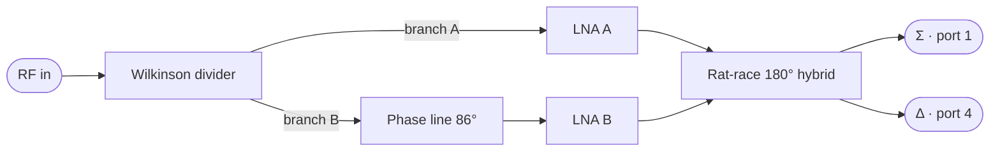

With identical amplifiers of gain G and a phase difference φ between branches:

- Σ = G·cos(φ/2) and Δ = G·sin(φ/2), so Δ/Σ = −j·tan(φ/2): the two outputs are always 90° apart.
- The phase line emulates two antennas separated by d = 0.7λ with a signal arriving at θ = 20°: φ = 2π·(d/λ)·sin θ = 86.19°.

## Design data

| Item | Value |
|---|---|
| Centre frequency | 7.5 GHz |
| Band | 7.125–7.875 GHz (10 %) |
| Substrate | Arlon 600: εr = 6, h = 0.6 mm, t = 35 µm, tan δ = 0.001 |
| Transistor | ATF-36163 at VDS = 1.5 V, ID = 10 mA |
| LNA targets | S21 > 10 dB, NF ≤ 1 dB, S11 ≤ −6 dB |
| Fabrication rule | Minimum line width and gap 0.15 mm |

| Line (mm) | Value |
|---|---|
| Width, 50 Ω | 0.870 |
| Width, 70.7 Ω | 0.416 |
| Quarter-wave arm, 70.7 Ω | 4.984 |
| Rat-race long arm (3λg/4) | 14.951 |
| Phase line, 50 Ω | 4.59 |

## Passive circuits

Every passive circuit was designed first with ideal transmission lines (TLIN) and then in microstrip (MLIN, MTEE, MCURVE).

### Wilkinson divider

| | Ideal | Real |
|---|---|---|
| \|S21\| = \|S31\| at 7.5 GHz | −3.01 dB | −3.11 dB |
| Worst matching in band | −31.1 dB | −29.7 dB |
| Worst isolation (S23) in band | −31.1 dB | −28.0 dB |
| Bandwidth with all reflections and isolation ≤ −20 dB | 6.15–8.85 GHz (36 %) | ≈ 6.1–8.6 GHz (≈ 33 %) |

Both outputs stay in phase. The real divider is slightly shifted down in frequency (isolation minimum at 7.36 GHz), so it loses bandwidth on the upper side.

| Ideal | Real | Phase |
|---|---|---|
| 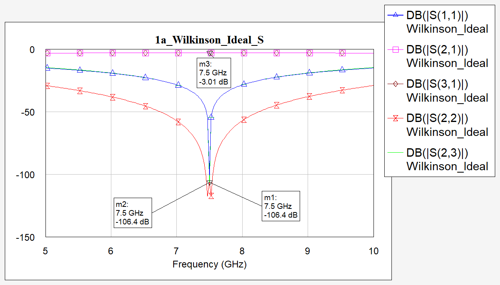 | 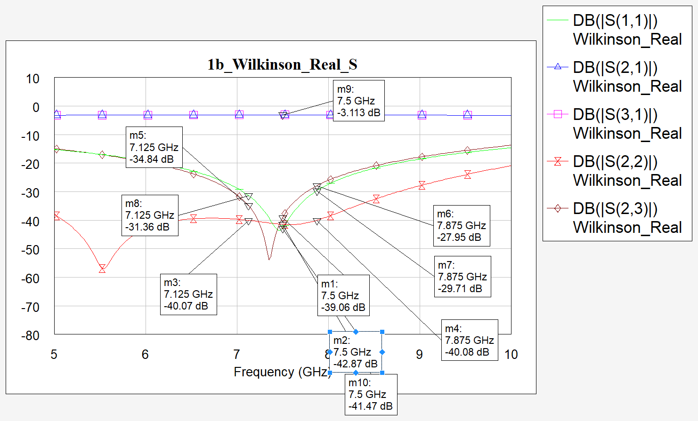 | 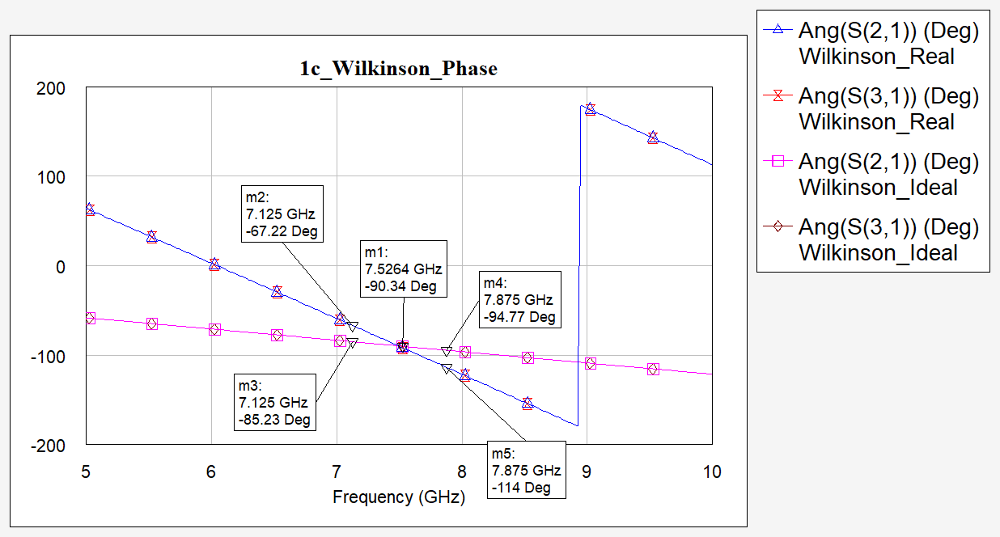 |

### Rat-race hybrid

| | Ideal | Real |
|---|---|---|
| \|S12\|, \|S13\| at 7.5 GHz | −3.01 dB | −3.11 dB |
| S11 at 7.5 GHz | −∞ | −38.5 dB |
| S14, S23 at 7.5 GHz | −∞ | −52.8 dB |
| Phase S42 − S43 at 7.5 GHz | 180.0° | 180.3° |
| Phase imbalance at the band edges | ±3.2° | +3.3° / −3.0° |
| Bandwidth with S11, S14, S23 ≤ −20 dB | 6.46–8.54 GHz (28 %) | ≈ 6.5–8.7 GHz (≈ 29 %) |

The phase balance limits the processor: the ideal hybrid stays within ±5° from 6.90 to 8.10 GHz (16 %), still wider than the 10 % required.

| Ideal | Real |
|---|---|
| 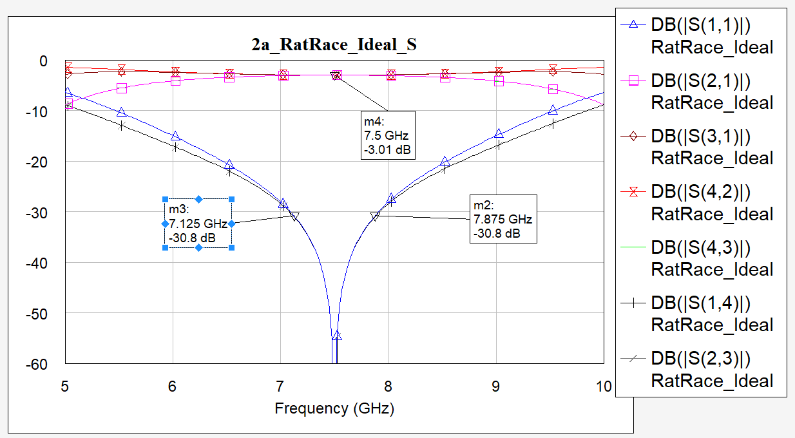 | 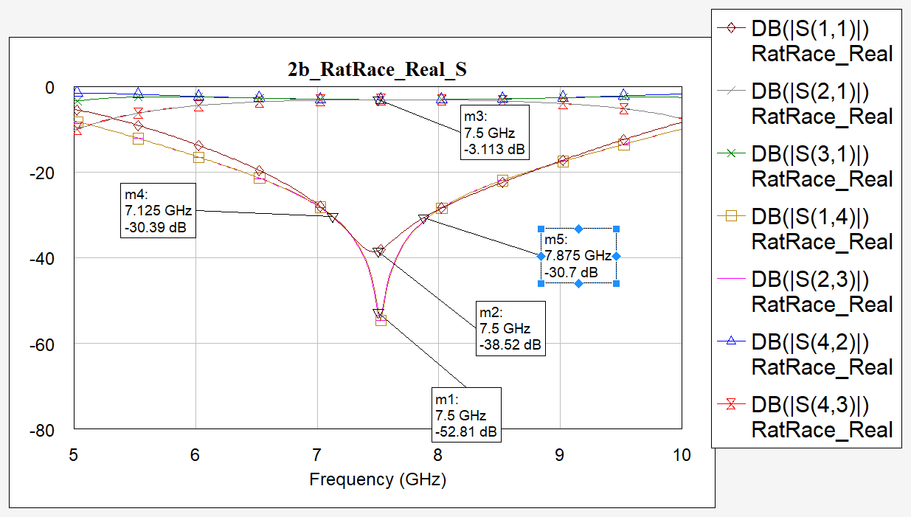 |
| 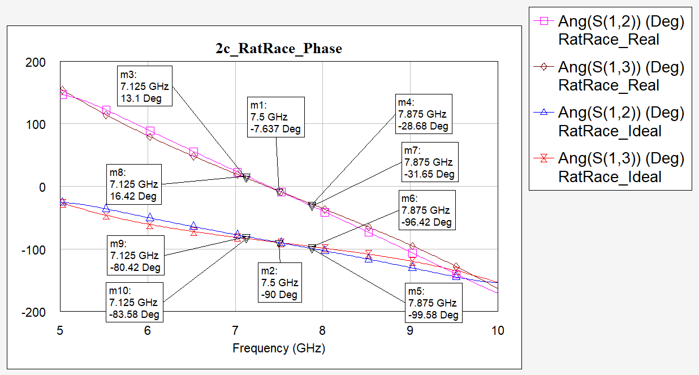 | 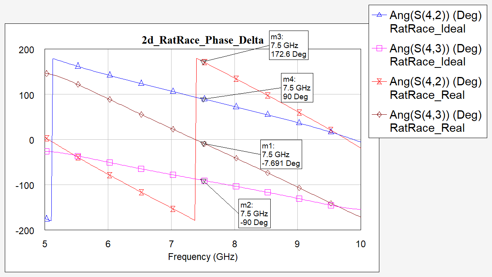 |

### Phase-shifting line

The ideal TLIN of 86.19° at 7.5 GHz becomes a 50-Ω microstrip line of 4.59 mm: −86.02° and −0.019 dB at 7.5 GHz. Its phase goes from about 82° to 90.5° across the band.

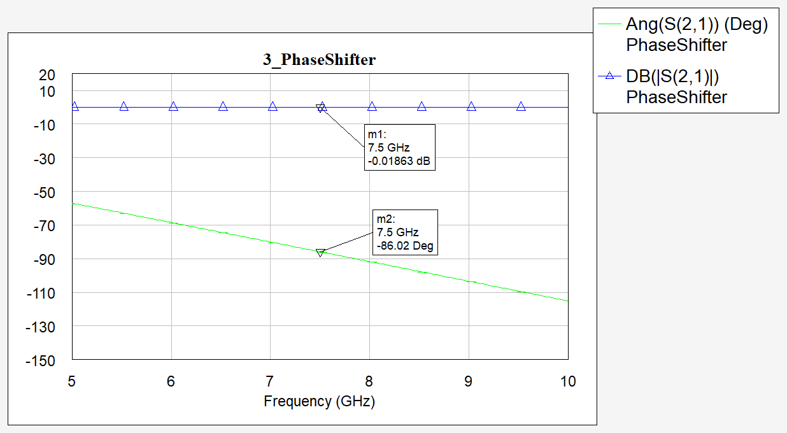

## Low-noise amplifier

**Design decisions**

- **Minimum noise:** the LNA is the first active stage of the receiver, so it sets the system noise figure (Friis). The source is matched to Γopt = 0.43∠112° (Fmin = 0.74 dB at 7.5 GHz).
- **Output:** conjugate match to Γout once Γs is fixed. The transistor is only conditionally stable at 7.5 GHz (K = 0.93, MSG = 13.9 dB).
- **Distributed bias:** at 7.5 GHz lumped inductors are unreliable, so λ/4 lines ending in RF shorts feed gate and drain, with 10-pF DC blocks at the RF ports.
- **Optimisation:** matching tuned with the AWR optimizer over the band (goals: NF < 0.95 dB with the highest weight, S21 > 10.5 dB, S11 < −6.3 dB, S22 < −9 dB). Narrow 70-Ω sections of 0.5 mm at the transistor pads give about 0.3 mm of clearance.

**Results**

| dB | 7.125 GHz | 7.5 GHz | 7.875 GHz |
|---|---|---|---|
| S21 | 12.42 | 11.81 | 11.27 |
| S11 | −6.49 | −7.10 | −7.03 |
| S22 | −11.09 | −10.18 | −9.32 |
| NF | 0.944 | 0.903 | 0.901 |

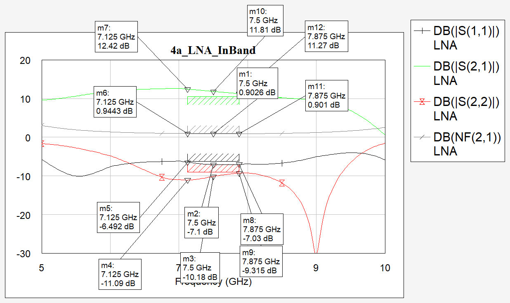

**Stability.** With a bypass capacitor at the gate, |S11| exceeded 0 dB out of band (negative input resistance). Replacing it with a λ/4 open stub keeps the RF short only around 7.5 GHz, so out of band the 50-Ω bias resistor loads the gate. Result: μ ≥ 1 outside 4.8–9.2 GHz, and |S11|, |S22| < 0 dB from 0.5 to 18 GHz. Inside the band the device remains conditionally stable, but in the processor each LNA always sees the matched ports of the hybrids.

| Stability factors | Reflections |
|---|---|
| 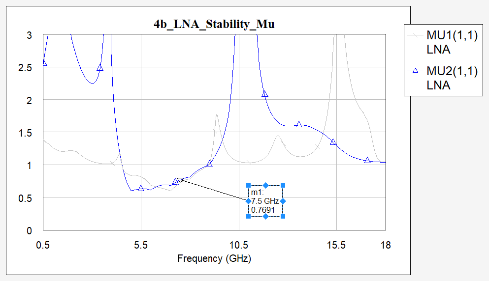 | 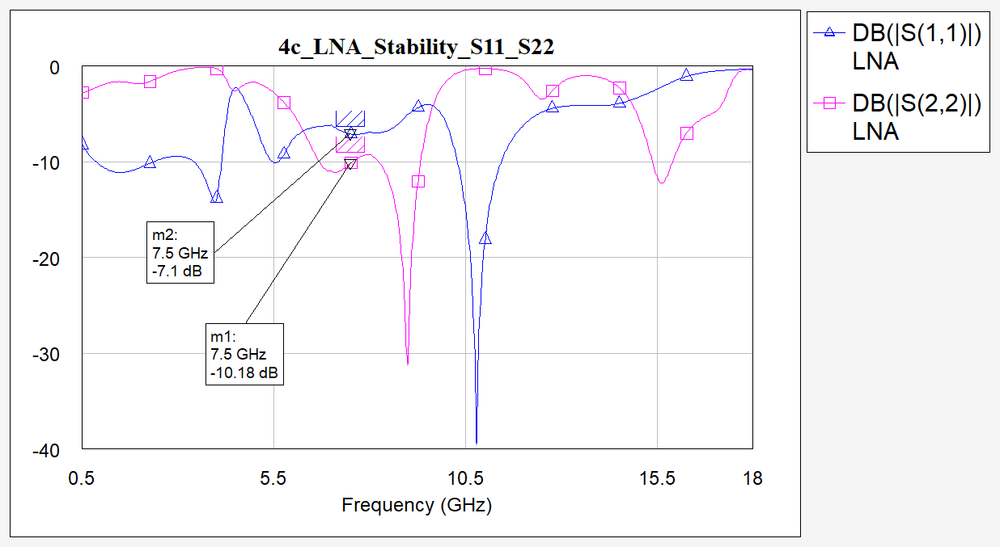 |

**Bias network.** Removing the bias network changes the NF by at most 0.04 dB and S21 by at most 0.55 dB in band. S22 changes by up to 1.9 dB at the upper edge, because the small residual reactance of the drain branch is part of the optimised output match.

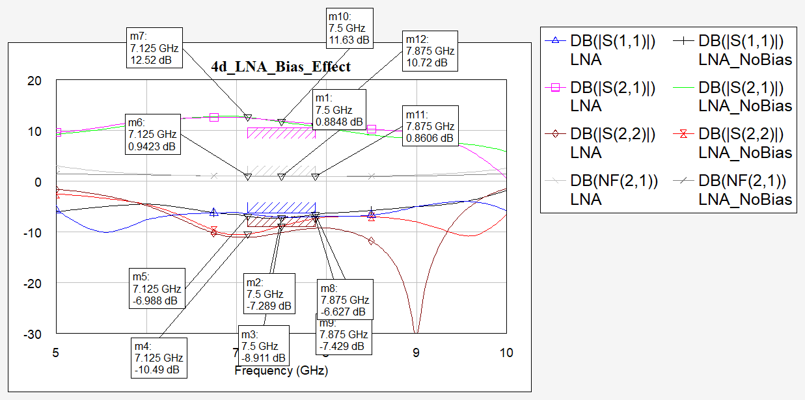

## Processor

### Phase shift φ = 86°

| | 7.125 GHz | 7.5 GHz | 7.875 GHz |
|---|---|---|---|
| Σ (dB) | 9.47 | 8.85 | 8.05 |
| Δ (dB) | 8.76 | 8.13 | 7.83 |
| NF Σ (dB) | 3.80 | 3.80 | 3.96 |
| NF Δ (dB) | 4.46 | 4.39 | 4.23 |
| S11 (dB) | −25.8 | −31.1 | −32.6 |
| Phase Σ − Δ | 87.3° | 89.7° | 92.4° |

- Both outputs sit about 3 dB below the LNA gain, as cos(43°) and sin(43°) predict.
- The input match is far better than that of a single LNA: the 86° line returns the two LNA reflections almost in antiphase, so they cancel at the Wilkinson input.
- NF of each port ≈ NF of the LNA + (G of the LNA − G of the port): the noise of both LNAs splits evenly between Σ and Δ, the signal does not.

| Magnitudes | Phase |
|---|---|
| 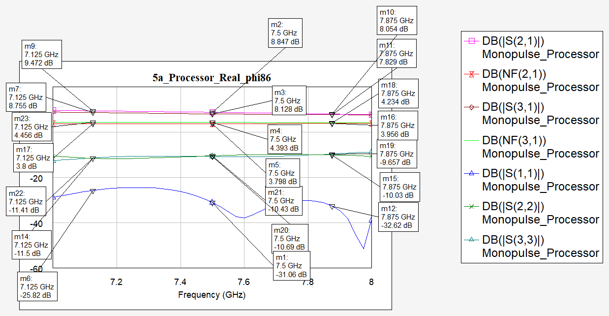 | 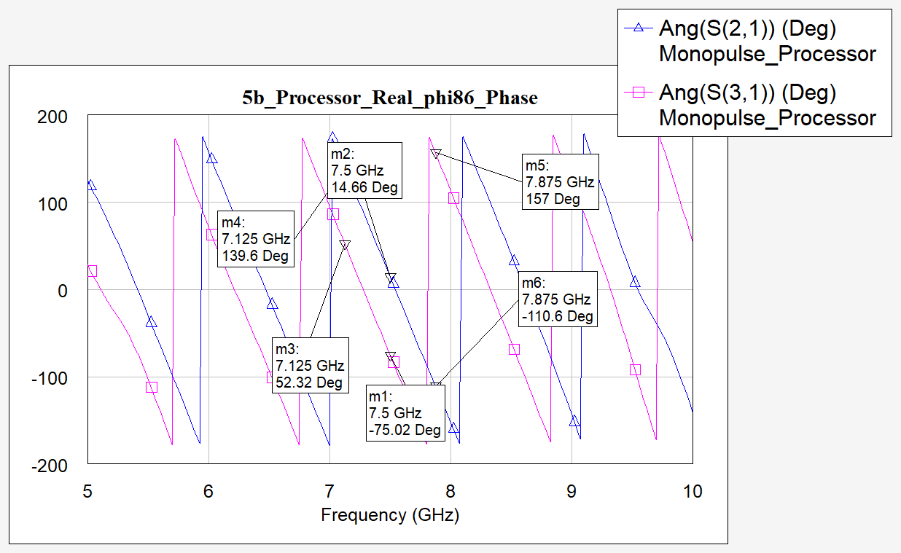 |

### Phase shift φ = 0

| | 7.125 GHz | 7.5 GHz | 7.875 GHz |
|---|---|---|---|
| Σ (dB) | 12.25 | 11.51 | 11.13 |
| NF Σ (dB) | 1.12 | 1.07 | 1.09 |
| Δ (dB) | −15.8 | −42.0 | −22.1 |
| S11 (dB) | −7.3 | −7.4 | −7.7 |

All the power goes to Σ (LNA gain minus about 0.3 dB of hybrid losses) and Δ becomes a null, limited by the phase imbalance of the hybrids. Without the phase line there is no reflection cancellation, so S11 equals the LNA input match.

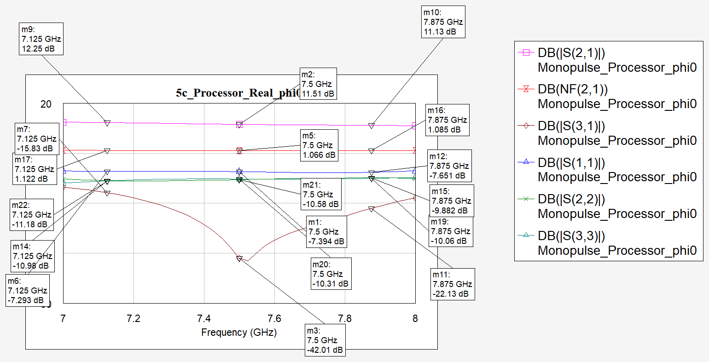

### Reference: ideal hybrids with the real LNAs

| φ = 86° | φ = 86°, phase | φ = 0 |
|---|---|---|
| 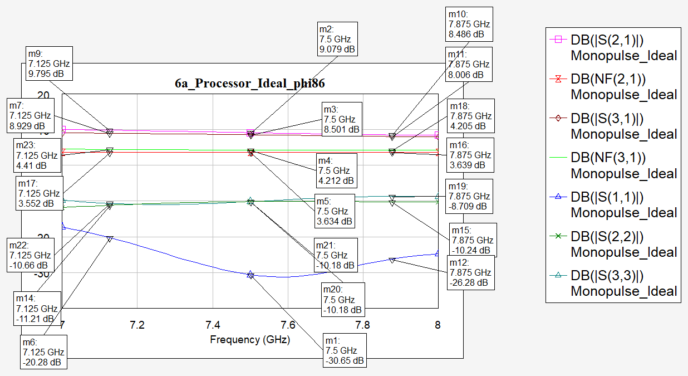 | 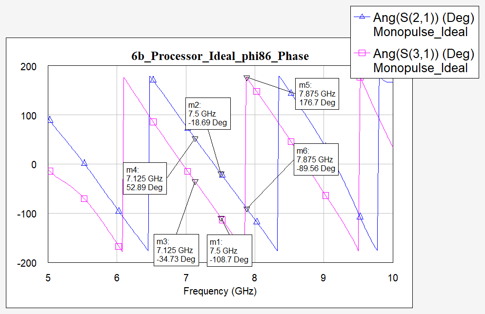 | 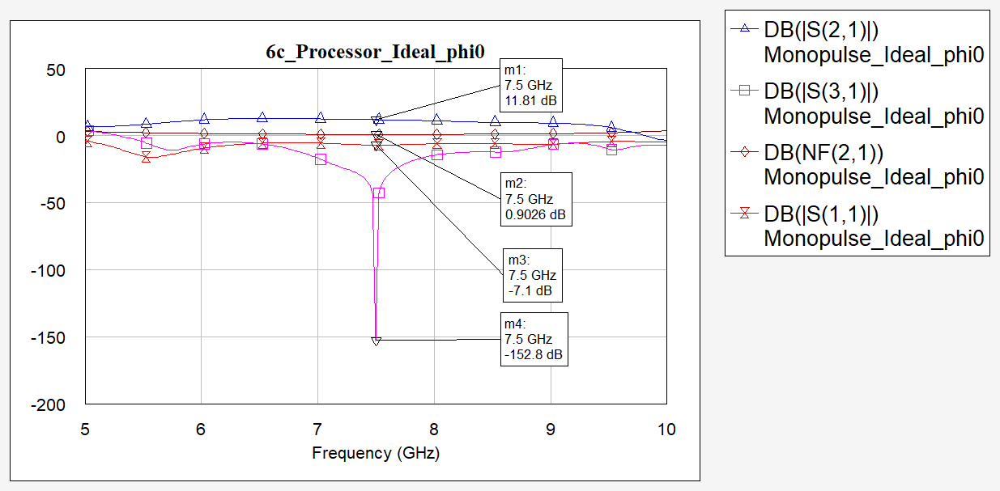 |

At 7.5 GHz the ideal version gives Σ = 9.08 dB and Δ = 8.50 dB at φ = 86°, so the microstrip hybrids cost about 0.2–0.4 dB.

## Repository contents

```
awr/Monopulse_Processor.emp   AWR Design Environment project: schematics, layouts, graphs and optimizer goals
figures/                      Graphs exported from the project
```

Open the project in AWR Design Environment (Microwave Office) with File → Open Project. The ATF-36163 S-parameter data used by the amplifier is embedded in the project.

## Scope and limitations

- Circuit-level (linear) simulation with microstrip models; no electromagnetic simulation.
- The circuits were not fabricated or measured.
- The transistor source pads are left unconnected in the layout; a fabricated board would need a via (MVIA) to the ground plane at each one.
- The processor layout keeps a sub-micron closure residual in the loop between the two branches, far below the 0.15-mm fabrication resolution.

## Tools

AWR Design Environment (Microwave Office) and TXLINE.
