# Dipole Antenna at 7.5 GHz in Ansys HFSS

Design and full-wave simulation of a half-wavelength dipole antenna in **Ansys HFSS** (Ansys Electronics Desktop 2025 R1). The dipole works in the 7.125–7.875 GHz band. The study covers matching, input impedance, gain and efficiency, 3D and 2D radiation patterns, and the surface current, and it repeats the pattern and current analysis for λ/4 and λ electrical lengths.

Lab project for the course *Radio Frequency and Antenna Subsystems*, MSc in Telecommunication Engineering, Universidad Carlos III de Madrid (2026).

## Highlights

- **Resonance at 7.50 GHz** (S11 = −17.2 dB), with a −10 dB impedance bandwidth of 7.08–7.99 GHz (12.1 %).
- **Peak realized gain 2.40 dBi**; directivity 2.38 dBi and gain 2.48 dBi at 7.5 GHz.
- **Half-power beamwidth** of 86.6°, 77.4° and 45.0° for λ/4, ≈λ/2 and λ, within 0.4–3° of thin-wire theory.
- **Surface current** with one maximum at the feed (λ/4, λ/2) and two maxima at mid-arm with a minimum at the feed (λ), as theory predicts.

The full write-up, with every figure and its discussion, is in [`report/Dipole_HFSS_Report.pdf`](report/Dipole_HFSS_Report.pdf), and the slides presented in class are in [`presentation/Dipole_HFSS_Presentation.pdf`](presentation/Dipole_HFSS_Presentation.pdf).

## Design

<p align="center">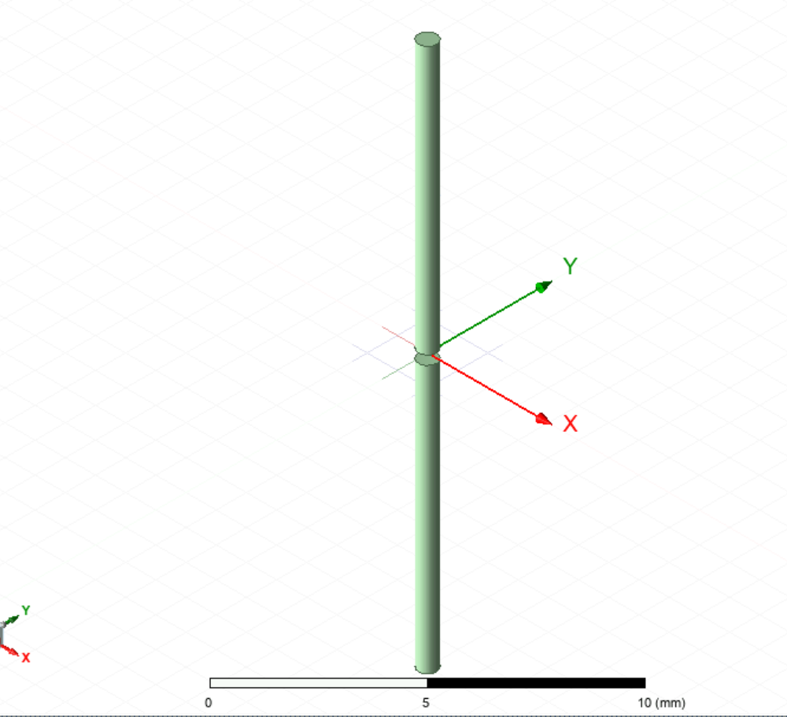 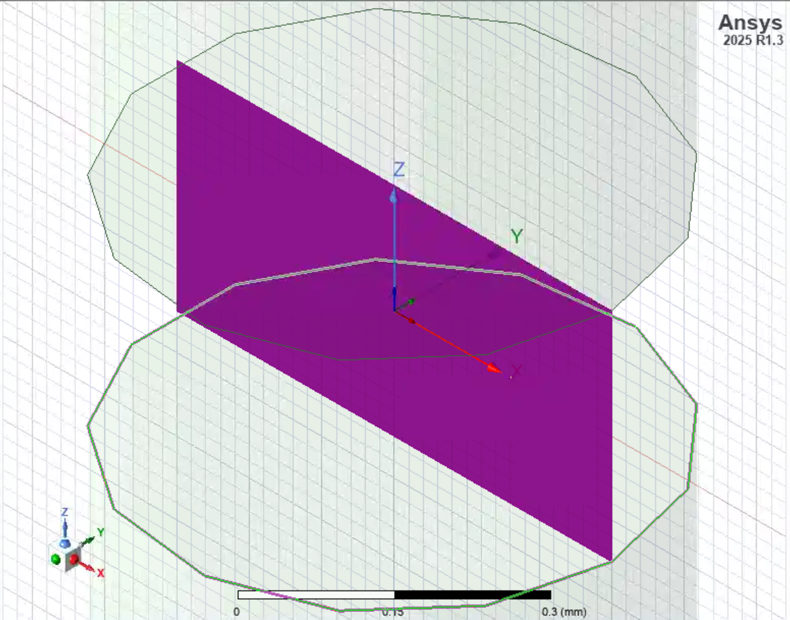</p>

| Parameter | Value |
|---|---|
| Wire radius | 0.30 mm |
| Feed gap | 0.30 mm |
| Arm length | 8.75 mm |
| Total length L | 17.80 mm = 0.445 λ0 at 7.5 GHz |
| Material | PEC |
| Excitation | 50 Ω terminal lumped port in the gap |
| Solution | HFSS Hybrid & Arrays, terminal, auto-open radiation region |
| Adaptive mesh | 7.5 GHz, max ΔS = 0.02 |
| Sweeps | Interpolating 3–12 GHz (10 MHz) for S11/Z11; discrete 3–13 GHz (0.1 GHz) plus 4.21 and 16.84 GHz with fields saved |

The starting geometry was the 2.4 GHz dipole of the HFSS tutorial, scaled by 2.4/7.5. A PEC structure in free space scales exactly with frequency. The arm length was then tuned (8.84 → 8.78 → 8.75 mm) to put the S11 minimum at 7.50 GHz. The dipole ends up shorter than λ/2 because an ideal λ/2 dipole has Zin = 73 + j42.5 Ω, and shortening it cancels that inductive reactance.

## Results

### Matching and impedance

| S11 | Z11 |
|---|---|
| 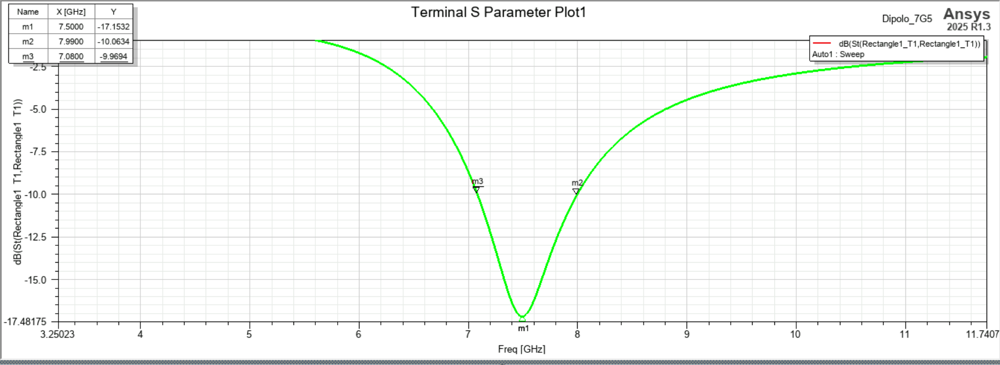 | 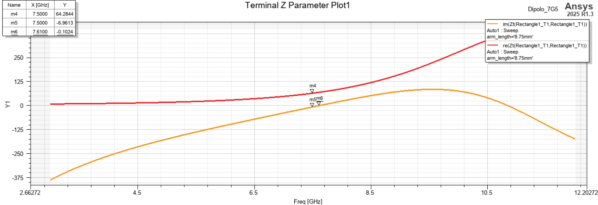 |

At 7.5 GHz, Z11 = 64.3 − j7.0 Ω. It becomes purely real at 7.61 GHz, slightly above the S11 minimum.

### Gain and efficiency

| Peak realized gain | Total efficiency |
|---|---|
| 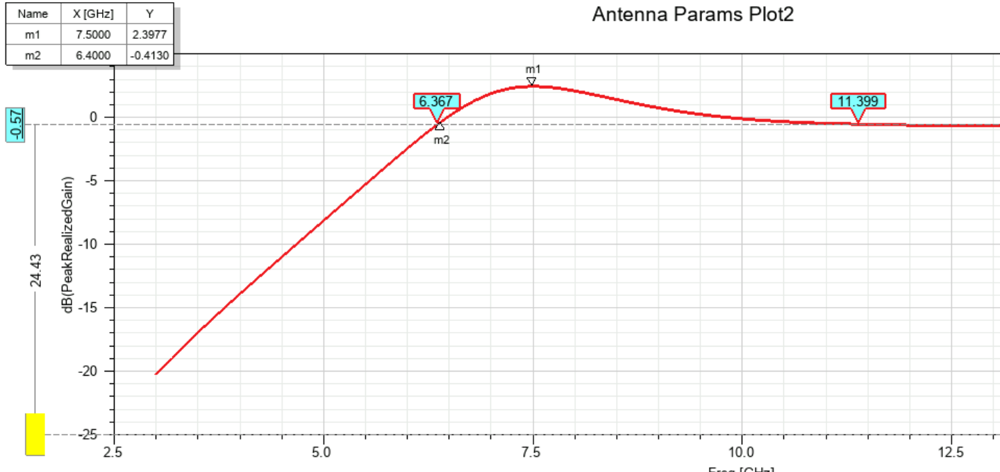 | 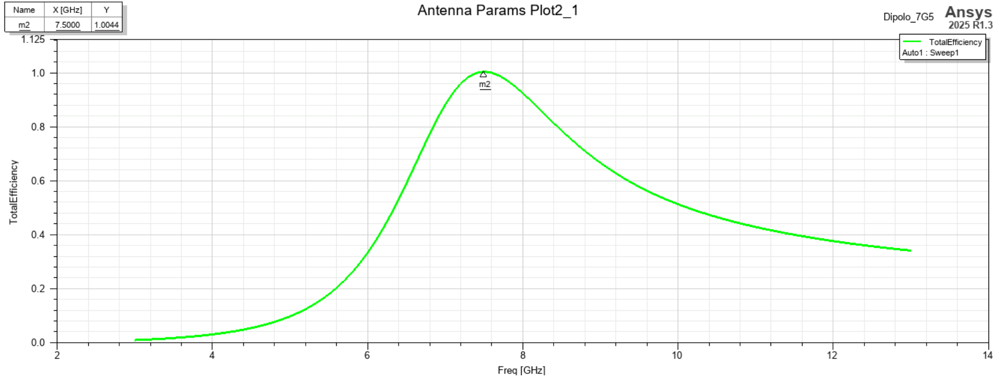 |

The realized gain stays within ≈3 dB of its maximum from 6.37 GHz to ≈11.4 GHz. That is far wider than the impedance bandwidth: a 3 dB drop needs about half the power to be reflected, and directivity grows above resonance. The total efficiency follows 1 − |S11|², since the PEC dipole has no ohmic losses.

### Radiation patterns

| 3D directivity | 3D gain |
|---|---|
| 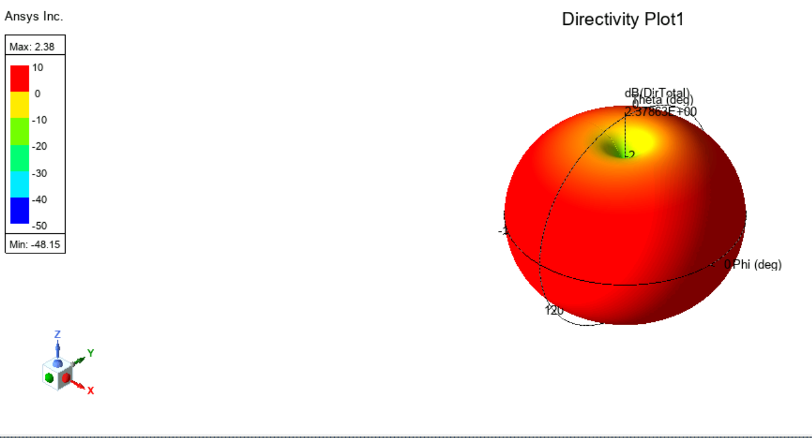 | 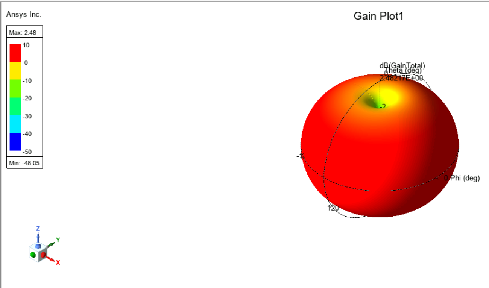 |

The λ/4 and λ cases keep the same structure and change only the frequency, so that the real length of 17.80 mm matches those electrical lengths: f = c/(4L) = 4.21 GHz and f = c/L = 16.84 GHz.

| Case | Frequency | Elevation cut (cyan) and azimuth cut (magenta) | HPBW simulated | HPBW theory |
|---|---|---|---|---|
| λ/4 | 4.21 GHz | 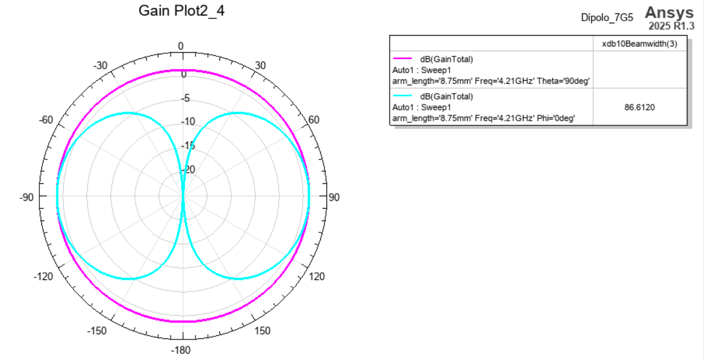 | 86.6° | 87° |
| ≈λ/2 | 7.50 GHz | 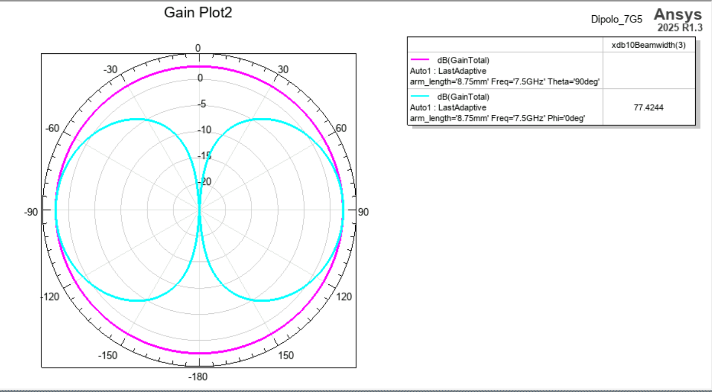 | 77.4° | 80.6° (0.445λ), 78° (λ/2) |
| λ | 16.84 GHz | 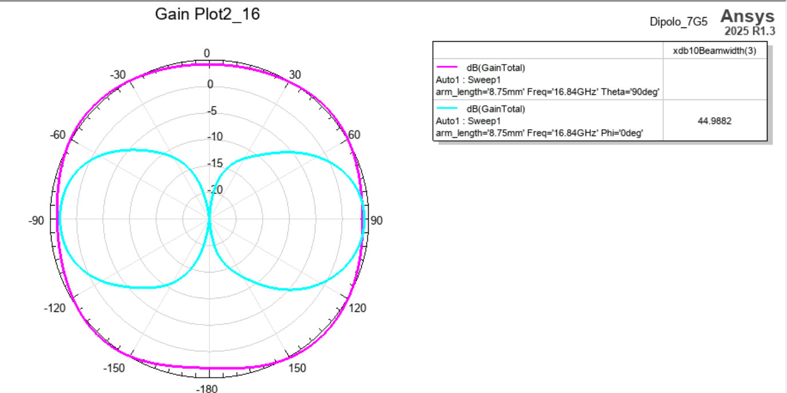 | 45.0° | 47.8° |

### Surface current

| λ/4 (4.21 GHz) | ≈λ/2 (7.5 GHz) | λ (16.84 GHz) |
|---|---|---|
| 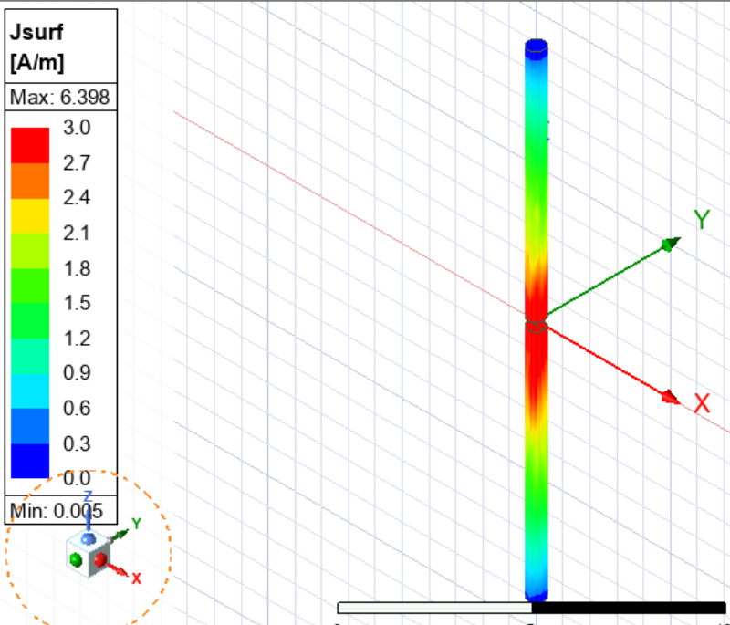 | 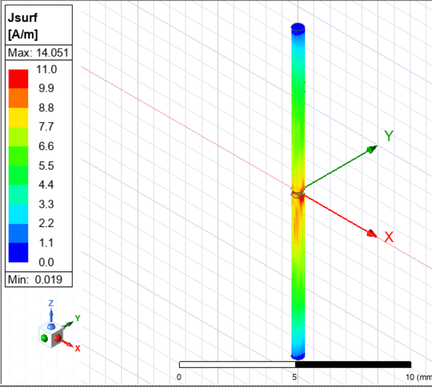 | 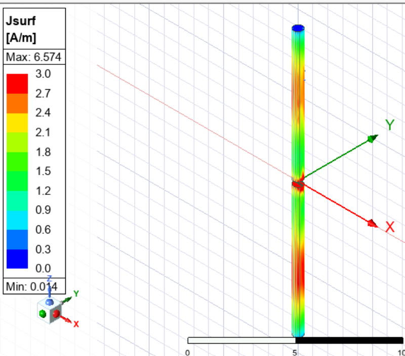 |

## Repository contents

```
hfss/Dipole_7G5.aedt           HFSS project: geometry, port, setup, sweeps and all reports
report/Dipole_HFSS_Report.pdf  Full report with figures and discussion (LaTeX)
presentation/                  Slides presented in class (PDF)
figures/                       Figures used in this README and in the report
```

The solved results (`Dipole_7G5.aedtresults`, about 250 MB) are too large for the repository. They are attached to the [latest release](../../releases/latest) as `Dipole_7G5_aedtresults.zip`. To open the project with every solution already computed, unzip that file into `hfss/`, next to `Dipole_7G5.aedt`, and open the project in Ansys Electronics Desktop 2025 R1 or later. Without it, run **Analyze All** to regenerate the solutions; all reports update automatically.

## Scope and limitations

- Simulation only: the dipole was not built or measured.
- The simulated radiation efficiency is 1.02 instead of exactly 1 for a PEC antenna, a ≈2 % numerical error in the radiated power.
- Theoretical values come from the thin-wire sinusoidal-current model (Balanis, *Antenna Theory*, Sec. 4.5–4.6). The finite wire radius explains the small deviations at 7.5 and 16.84 GHz.
